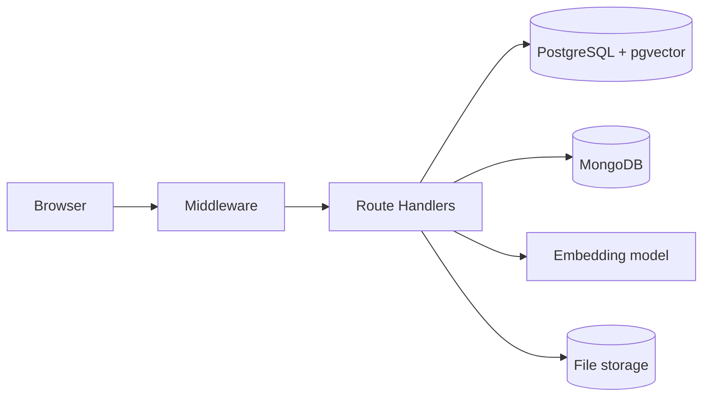

# ProjectPulse

**Academic Project Governance, Originality and Milestone Risk Monitor**: DBMS Experiential Learning, Level 3 project (instructor: Dr. Nagasundari S). Team: Chiranthan and Aadish.

ProjectPulse helps students, faculty guides, reviewers and administrators manage a college project from proposal to final evaluation, and warns faculty **early** about late milestones, unequal contribution, missing documents, unresolved feedback and proposals that overlap with another team's idea. Faculty keep every decision; the system only explains and flags.

## Features

- **Proposals**: draft, submit, approve / reject / request revision, with an immutable decision history.
- **Teams and allocation**: one team per student per course (enforced by the database), guide and reviewers per project.
- **Plan and delivery**: milestone templates, weighted milestones, task Kanban with owner / collaborators and guide verification, deliverables with file upload and version history, **atomic milestone submission** (all-or-nothing across PostgreSQL, MongoDB and the file store).
- **Quality loop**: reviews with rubric scores, feedback items (open, in progress, resolved, verified, reopened) with MongoDB discussion threads.
- **Evidence and fairness**: contribution evidence (only verified evidence counts), peer evaluation, a contribution view.
- **Risk monitoring**: explainable score with six factors, history and trend, overdue triggers, sweep job.
- **Originality**: semantic similarity (pgvector) flags possible overlap for faculty review; a student "Check originality" hint reveals nothing about other teams.
- **Interface**: clean black-and-white dark and light themes, a heartbeat motif that follows risk, animated gauge and counters, sidebar shell with a `⌘K` command palette, responsive down to phone width.
- **Dashboards and reports** for the four roles, filters, CSV export, MongoDB document insights, audit log, administration area.

## Tech stack

| Layer | Technology |
|---|---|
| Frontend | Next.js (App Router), React, TypeScript, Tailwind CSS |
| API | Next.js Route Handlers, Zod validation |
| SQL | PostgreSQL (raw SQL with `pg`; tables, views, functions, triggers, transactions) |
| NoSQL | MongoDB (`$jsonSchema` validators, aggregation pipelines) |
| Vector | pgvector in PostgreSQL, HNSW index, cosine distance; embeddings from `Xenova/all-MiniLM-L6-v2` (384-d, runs locally) |
| Auth | bcrypt + JWT in an HttpOnly cookie (`jose`) |
| Tests | Vitest (database, unit, API) |



## Prerequisites

- Node.js 20 or newer (developed on 24) and npm
- PostgreSQL 16 or newer **with the `pgvector` extension**, and MongoDB 7. Either install them natively
  (macOS: `brew install postgresql@18 pgvector mongodb-community@7.0`) or use Docker: `npm run db:up` (set `PG_SUPERPASSWORD` in `.env`)
- Internet access once, to download the ~25 MB embedding model on first use and the web fonts (`next/font`) on the first dev run or build
- Git

## Setup

```bash
git clone <repository-url> projectpulse && cd projectpulse
cp .env.example .env        # then fill in real values locally (never commit .env)
npm install
npm run db:up               # only if you use Docker; skip when PostgreSQL and MongoDB already run
npm run db:migrate          # creates the database if missing, applies db/migrations/*.sql (progress bar)
npm run db:seed             # demo data: PostgreSQL + MongoDB + embeddings (progress bars)
npm run dev                 # http://localhost:3000
```

For the hosted deployment, see [Render deployment](docs/DEPLOY_RENDER.md). The Next.js frontend and API run on Render, PostgreSQL with pgvector runs on Neon, and MongoDB plus private uploads run on Atlas. The earlier [Vercel deployment](docs/DEPLOY_VERCEL.md) remains an alternative when fixed outbound IPs are available.

Individual steps: `npm run mongo:init` (collections, validators, indexes; the seed does it too), `npm run embed:backfill` (embeddings and similarity screening), `npm run risk:sweep` (fresh risk snapshots), `npm run mongo:reconcile` (repair the MongoDB side from PostgreSQL), `npm run db:reset` (drop the schema and re-migrate; the next `db:seed` rebuilds the demo).

### Environment variables

Real values live only in `.env`, which is git-ignored. `.env.example` has placeholders.

| Variable | Purpose |
|---|---|
| `DATABASE_URL` | App connection, as the least-privilege role `pp_app` |
| `MIGRATION_DATABASE_URL` | Owner connection used by migrations and seeding |
| `APP_DB_PASSWORD` | Password migration 013 gives the `pp_app` role |
| `DB_SEARCH_PATH` | `projectpulse,public` |
| `MONGODB_URI`, `MONGODB_DB` | MongoDB connection |
| `AUTH_SECRET` | Signs session tokens (long random string) |
| `SESSION_MAX_AGE_HOURS` | Session length (default 8) |
| `STORAGE_DRIVER`, `STORAGE_LOCAL_PATH`, `STORAGE_MAX_FILE_MB` | Local upload folder or private Vercel Blob store and size limit |
| `BLOB_READ_WRITE_TOKEN` | Private Vercel Blob store token when `STORAGE_DRIVER=vercel-blob` |
| `SKIP_DATABASE_CREATE` | Set to `1` when using a managed database that is already provisioned |
| `EMBEDDING_PROVIDER`, `EMBEDDING_MODEL`, `EMBEDDING_DIM` | Local embedding model and its dimension (384) |
| `SIMILARITY_THRESHOLD`, `SIMILARITY_TOP_K` | Overlap threshold (0.80) and number of matches kept |
| `JOB_SECRET` | Lets a scheduler call `POST /api/jobs/risk-sweep` (header `x-job-secret`) |
| `SEED_DEFAULT_PASSWORD` | Password given to every demo account by the seed (only used there) |
| `SEED_EMBEDDINGS` | `0` skips embeddings during the seed |
| `ENABLE_TEST_HOOKS` | Test only: lets API tests force a failure inside the submission (never honoured in production) |

### Demo accounts

All use the password you set as `SEED_DEFAULT_PASSWORD`.

| Role | Accounts |
|---|---|
| Admin | `admin@projectpulse.test` |
| Faculty guides | `guide1@` (Pavan AC), `guide2@`, `guide3@projectpulse.test` (guide3 is also a reviewer: use the role switcher) |
| Reviewers | `reviewer1@`, `reviewer2@projectpulse.test` |
| Students in a team | `student01@` (Aadish) to `student14@projectpulse.test` |
| Students with no team yet | `student15@` to `student20@projectpulse.test`, or create your own at `/register` |
| Guide with no projects | `guide4@projectpulse.test` (Prof. Suresh Nayak) |

Six demo teams show different situations: **Alpha** healthy (student01 to 03, guide1), **Bravo** delayed and high risk (student04, 05, guide2), **Charlie** unequal contribution (student06 to 08, guide1), **Delta** unresolved feedback and a missing test report (student09, 10, guide2), **Echo** a near-duplicate of Alpha awaiting similarity review (student11, 12, guide1), **Foxtrot** a similar topic in another course, revision requested (student13, 14, guide3).

### Try the whole workflow from scratch

Use the free accounts so nothing is pre-filled. The same journey is checked end to end through the interface.

1. **Student** (`student15`): Teams, create a team and add `student16`; Proposals, New proposal, then Save and submit.
2. **Admin**: Admin, Allocations, give the new project a guide (`guide4`) and a reviewer (`reviewer1`).
3. **Guide** (`guide4`): open the proposal and approve it (or ask for a revision).
4. **Student**: Milestones, create them from a template and start the first; Task board, add tasks and mark them done; Deliverables, add a file and submit the milestone.
5. **Guide**: Milestones, start the review and approve; verify tasks and evidence. **Reviewer**: Feedback, fill the rubric and add feedback items.
6. **Student**: answer and resolve the feedback; rate teammates under Contribution. **Guide**: verify the fix, recalculate the risk.
7. A second new team that submits a similar idea appears under **Similarity** for faculty review.
8. **Admin** can add users, departments, courses and templates; anyone can change their password under **Account**.

## Tests

```bash
npm test                                       # database tests (constraints, triggers, views, queries, vector, MongoDB) and unit tests
ENABLE_TEST_HOOKS=1 npm run dev -- -p 3100     # in another terminal: API tests need the app running on port 3100
npm test                                       # now the read-only API tests run too
ALLOW_MUTATING_TESTS=1 npm test                # also the workflow, upload, rollback, similarity, peer-evaluation and admin tests
npm run test:report                            # full run + docs/TEST_RESULTS.md (T-01 ... T-30)
```

Tests that change data **restore the demo automatically** at the end (`db:reset` + `db:seed`). API tests are skipped, not failed, when the app is not running.

## Project structure

```
db/migrations/   versioned SQL (001 ... 014)         db/queries/   important_queries.sql (Q1 ... Q14)
db/seeds/        demo scenarios (PostgreSQL, MongoDB) db/mongo/     collections + aggregation pipelines
db/tests/        database tests                       tests/        API + unit tests
scripts/         migrate, reset, seed, embed-backfill, risk-sweep, mongo-init / reconcile, docs generators
src/app/         Next.js pages and api/ Route Handlers  src/lib/    auth, data access, embeddings, storage, risk
docs/            DECISIONS, data dictionary, ER diagram, EXPLAIN evidence, test results, report sources, screenshots
report.pdf       the project report
```

The original full build specification is preserved in [`docs/PROJECTPULSE_SPEC.md`](docs/PROJECTPULSE_SPEC.md).

## Database design (details in `docs/`)

- `docs/data_dictionary.md`, `docs/relational_schema.md`, `docs/er_diagram.mmd` / `er_overview.mmd`: **generated from the live schema** by `npm run docs:data-dictionary`.
- `docs/EXPLAIN_ANALYZE.md`: query plans before and after the indexes (`npm run docs:explain`).
- `docs/TEST_RESULTS.md`: results for every specification test case.
- `docs/DECISIONS.md`: every assumption and deviation from the specification, with the reason.
- `report.pdf`: the full project report (rebuild with `npm run docs:report`; screenshots with `npm run docs:screenshots`).

PostgreSQL is the system of record. Integrity rules live in the database (CHECK, foreign keys, partial unique indexes, triggers); orchestration that needs the user, files or two databases lives in the Route Handlers. A write that spans PostgreSQL, MongoDB and the file store is ordered so that a failure leaves nothing half-done.

## Troubleshooting

- `extension "vector" is not available`: install pgvector for your PostgreSQL version (`brew install pgvector`, or use the Docker image `pgvector/pgvector`).
- `Skipping 013` warning: set `APP_DB_PASSWORD` in `.env` so the `pp_app` role can be created.
- First similarity check or seed is slow: the embedding model (~25 MB) is downloaded once and cached; this needs internet. `SEED_EMBEDDINGS=0` skips it.
- `EADDRINUSE` or "port in use": start the app on another port, `npm run dev -- -p 3100`.
- MongoDB not running: the seed still finishes with a warning, but documents and discussion threads are missing until MongoDB is up and you re-run `npm run db:seed`.
- Login says "Too many failed attempts": the account is locked for 15 minutes; an admin can unlock it under Admin, Users.

## Team and contributions

Chiranthan and Aadish. The work is divided as in the proposal: database design, constraints, triggers, functions, queries and test data on one side; the Next.js interface, authentication and authorisation, the MongoDB model, the semantic-search module, dashboards and testing on the other; each member also contributes to the other half, and documentation is shared. Individual contributions are recorded in the commit history (`git shortlog -sn --all`).

## Credits

Built with Next.js, PostgreSQL, pgvector, MongoDB, Transformers.js and the `Xenova/all-MiniLM-L6-v2` sentence-embedding model. The project is original work for this course.
